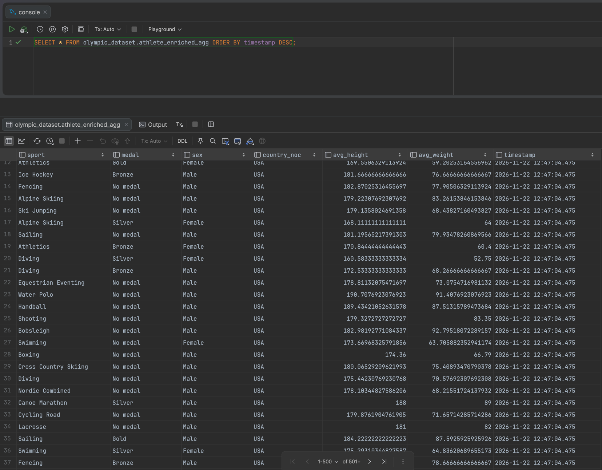
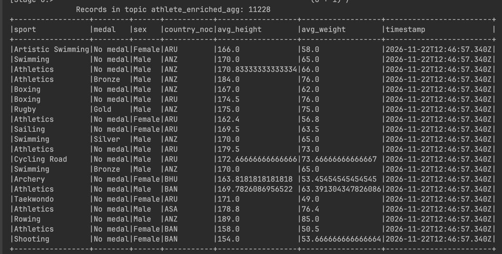
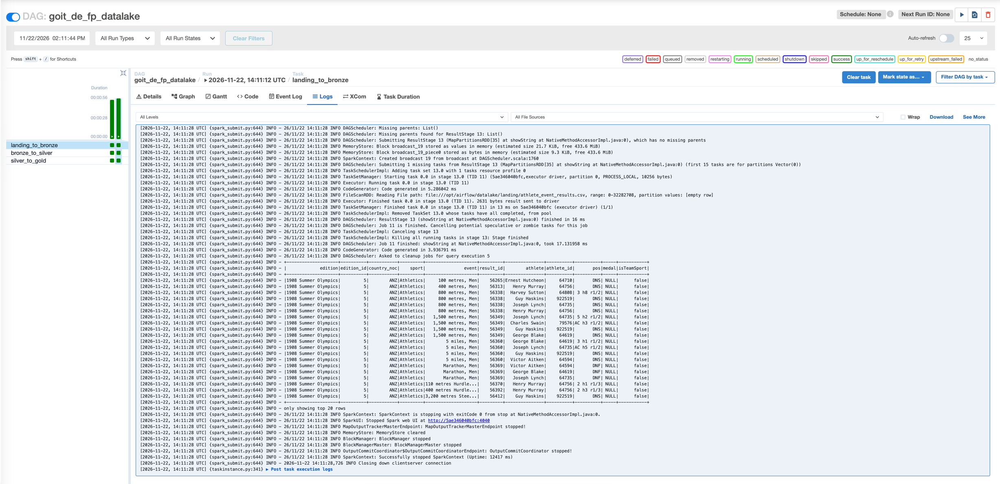
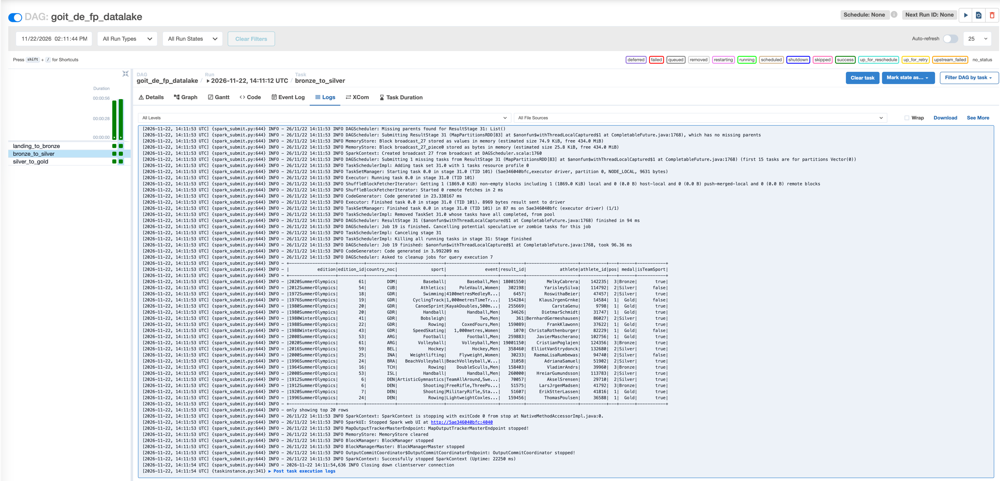
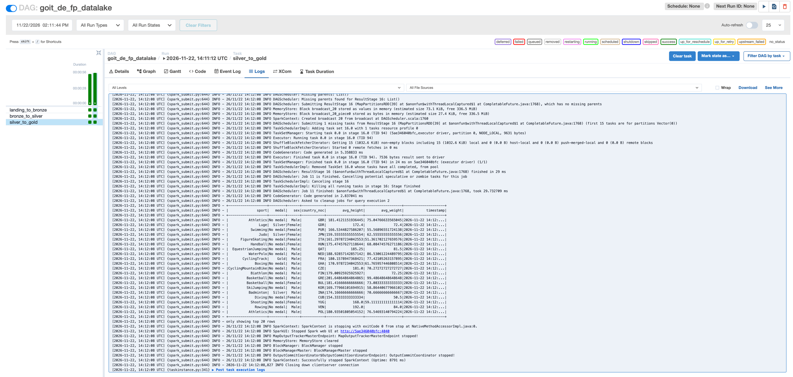
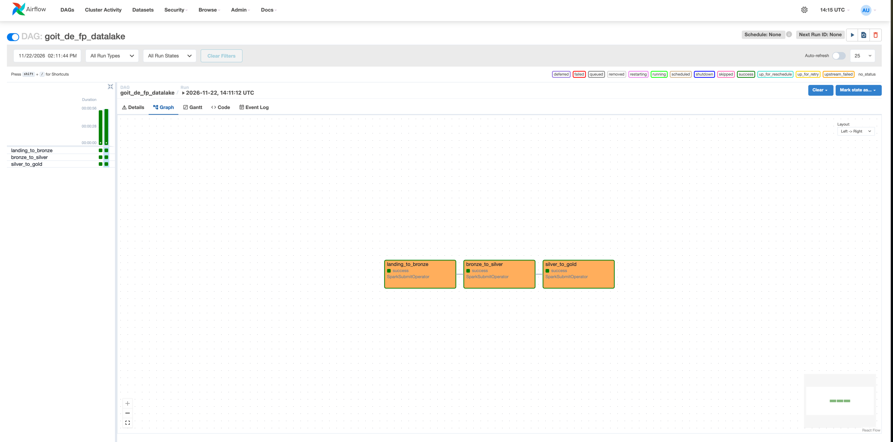

# goit-de-fp — Data Engineering final project

## Part 1. End-to-End Streaming Pipeline (`part1_streaming/`)

| Stage | Where |
|---|---|
| 1. Read athlete_bio from MySQL | `streaming_pipeline.py` |
| 2. Filter empty / non-numeric height & weight | `transformations.filter_valid_bio` |
| 3. MySQL athlete_event_results -> Kafka, Kafka -> DataFrame | `produce_event_results.py`, `streaming_pipeline.py` |
| 4. Join on athlete_id | `transformations.enrich_events` |
| 5. avg height/weight by sport, medal, sex, country_noc + timestamp | `transformations.aggregate_stats` |
| 6. forEachBatch -> Kafka topic + MySQL | `streaming_pipeline.make_batch_writer` |

Run order: `seed_mysql.py` -> `produce_event_results.py` -> `streaming_pipeline.py` -> `read_output_topic.py`.

### Screenshots

**MySQL table `olympic_dataset.athlete_enriched_agg` (stage 6.b)**

**Output Kafka topic `athlete_enriched_agg` (stage 6.a)**, printed by `read_output_topic.py`

## Part 2. Batch Data Lake (`part2_batch/`)

`landing_to_bronze.py` -> `bronze_to_silver.py` -> `silver_to_gold.py`, orchestrated by the
Airflow DAG `goit_de_fp_datalake` in `project_solution.py` (`docker compose up -d --build`,
UI http://localhost:8081).

### Screenshots

**landing_to_bronze — `df.show()` in the task log (bronze/athlete_event_results)**

**bronze_to_silver — `df.show()` in the task log (silver/athlete_event_results)**

**silver_to_gold — `df.show()` in the task log (gold/avg_stats)**

**Completed DAG run graph**

